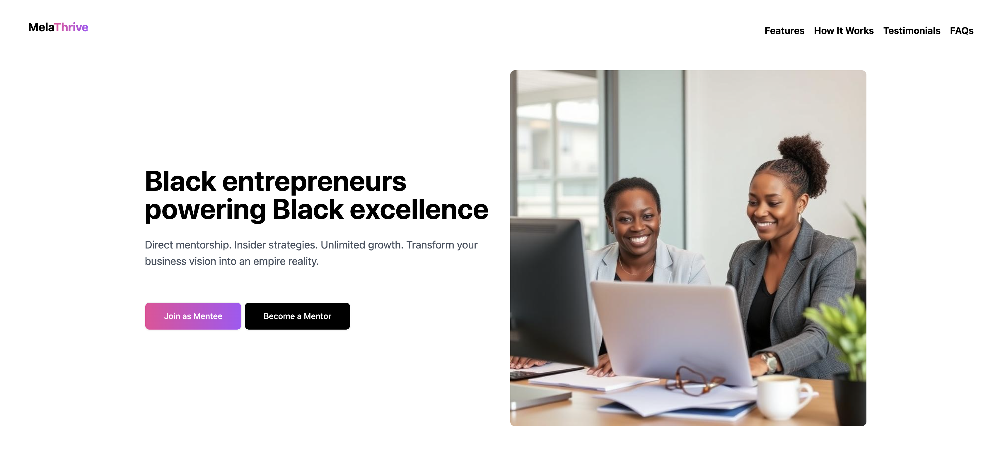

# MelaThrive 
 
  
<!-- Replace with an actual screenshot of your app -->

**Empowering Black entrepreneurs through mentorship.**  
MelaThrive is a platform that connects Black business owners with experienced mentors, offering guidance in areas like marketing, finance, and growth.  

---

## Live Demo  
[Click here to view](https://your-melathrive-link.netlify.app)  
<!-- Replace with your actual Netlify URL -->

---

## Tech Stack  
- Vue.js  
- TailwindCSS + DaisyUI  
- Supabase (PostgreSQL)  
- Netlify (Deployment)  

---

## Features  
- Landing page to collect data from potential mentors and mentees  
- Simple sign-up flow for interest submission  
- Mobile-friendly, responsive design  
- Foundation for future mentorship matching and community features  

---

